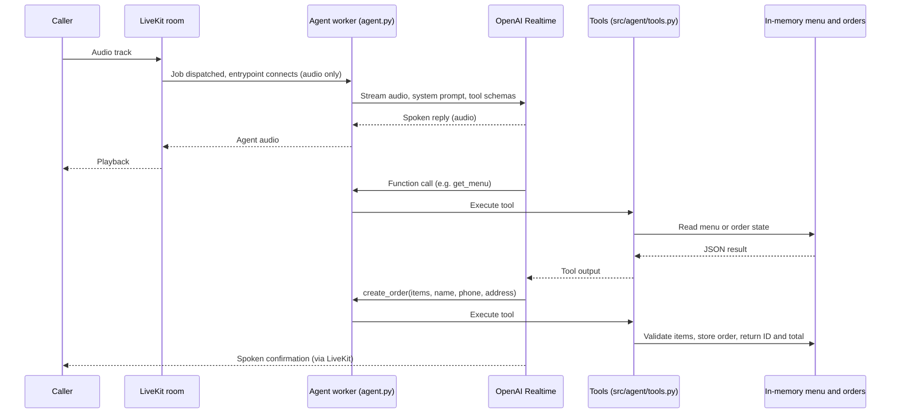

<div align="center">


**A compact voice agent that takes pizza orders by phone-style conversation, using tool calls against a mock menu and order backend.**


</div>

## Overview

A small, focused demo of a speech-to-speech ordering agent. A LiveKit Agents worker joins a room, hands the caller's audio to an OpenAI Realtime model, and lets the model call four Python tools to read the menu and create or look up orders. The pizzeria, menu and orders are fictional and live in memory. The agent persona speaks Ukrainian.

## Highlights

- Speech-to-speech through a single `gpt-realtime-mini` session: no separate STT, LLM or TTS stages are wired in the code.
- Four function tools exposed to the model: `get_menu`, `get_item_details`, `create_order`, `get_order_status`.
- Tools are validated against data: unknown or unavailable items are rejected by `create_order`, and the total is computed server-side from menu prices.
- Tolerant tool inputs: order IDs such as `101`, `ORD101` and `ORD-101` are normalized, status can be looked up by customer name, and Ukrainian category names map to canonical ones.
- A detailed system prompt (about 70 lines) constrains scope, price disclosure, availability wording and voice-friendly style, and refuses prompt-extraction requests.

## How it works



## Tech stack

| Layer | Choice |
| --- | --- |
| Language | Python |
| Realtime transport and worker | LiveKit Agents (`livekit-agents`, `AgentSession`, `cli.run_app`) |
| Voice model | OpenAI Realtime via `livekit-plugins-openai` (`gpt-realtime-mini`) |
| Tools | `llm.function_tool` with typed, annotated parameters |
| Data | Python dicts in `src/api/fake_api.py` (no database) |
| Config | `python-dotenv` |

## Quick start

Python version is not pinned in the repo; use a version supported by current `livekit-agents`. You need a LiveKit server (Cloud or self-hosted) and an OpenAI API key.

```bash
pip install -r requirements.txt
# create .env with the variables listed below
python agent.py dev
```

`dev` starts the worker in LiveKit's development mode. Connect to the room with any LiveKit client (for example the LiveKit Agents Playground) to talk to the agent.

## Configuration

Set in `.env` (git-ignored; loaded by `python-dotenv`). These are the standard variables read by the LiveKit CLI and the OpenAI plugin; `agent.py` itself does not read them directly.

| Variable | Purpose |
| --- | --- |
| `LIVEKIT_URL` | LiveKit server WebSocket URL (`wss://...`) |
| `LIVEKIT_API_KEY` | LiveKit API key |
| `LIVEKIT_API_SECRET` | LiveKit API secret |
| `OPENAI_API_KEY` | OpenAI key for the Realtime model |

## Project structure

```text
agent.py              Worker entrypoint: Agent, RealtimeModel, AgentSession
requirements.txt      livekit-agents, livekit-plugins-openai, python-dotenv
src/agent/prompts.py  System prompt (Ukrainian, pizzeria persona and rules)
src/agent/tools.py    Four function tools wrapping the mock API
src/api/fake_api.py   In-memory menu (10 items), seeded orders, order logic
```

## Status and roadmap

Working demo, not a product. Known limits:

- Orders and the ID counter live in process memory and are lost on restart; the "API" is a mock.
- `create_order` requires an address, so pickup orders are not modelled even though the prompt mentions pickup.
- Voice activity detection, turn handling and interruption settings use library defaults and are not tuned.
- No tests, no latency measurements, no LICENSE file, no deployment config.

Possible next steps: a real order backend, a pickup flow, tests for the tools, and measured latency.
